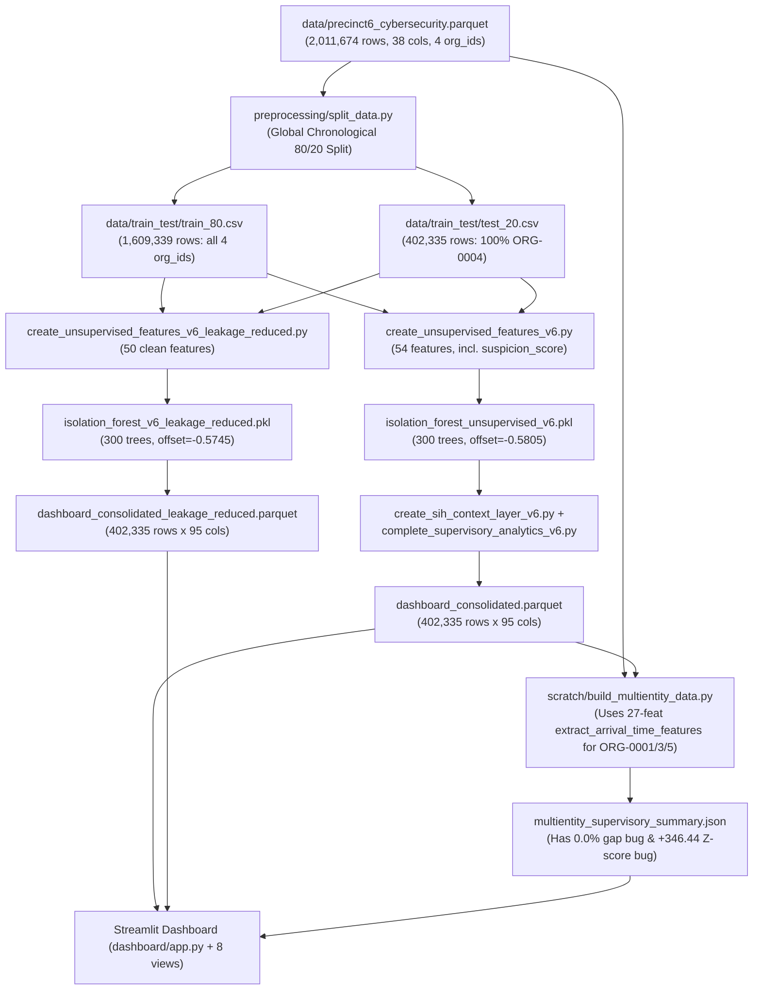

# MASTER PROJECT FORENSIC AUDIT — SAT-SA (SIH26157)

**Project:** Supervisory Analytics Tool for SOC Assessment (SAT-SA)  
**Problem Statement:** SIH26157  
**Organisation:** National Technical Research Organisation (NTRO) / NCIIPC  
**Project Directory:** `C:\Users\PALAK\Desktop\SOC_Alert_Triage`  
**Audit Date:** 2026-11-14  
**Audit Mode:** Strictly Read-Only Independent Forensic Verification (Zero Project Files Modified)

---

## 1. Executive Summary

This Master Project Audit consolidates the findings of a 14-phase independent technical forensic audit of the **Supervisory Analytics Tool for SOC Assessment (SAT-SA)** project (`SIH26157`). Every Python module, dataset, serialized model artifact, evaluation CSV/Parquet file, frontend view, and test script was inspected directly and verified via read-only execution.

### What Is Genuinely Strong & Verified
1. **Large-Scale Offline Unsupervised Isolation Forest Pipeline (`model/*_v6*.py`):**
   - Trained on **`1,609,339` alerts** (`train_80.csv`) and evaluated on **`402,335` unseen alerts** (`test_20.csv`).
   - Both the **54-feature Baseline V6 model** (`isolation_forest_unsupervised_v6.pkl`) and the **50-feature Leakage-Reduced model** (`isolation_forest_v6_leakage_reduced.pkl`) achieve **97.0%–99.0% Security-Relevant Precision@100** (against `13,390` verified security-relevant alerts carrying confirmed incident IDs or MITRE ATT&CK tactics/techniques) and discover **100% (`44 / 44`) of unique confirmed incidents within the Top 25,000 alerts** (`6.21%` of the queue, `93.79%` workload reduction).
2. **Single-Entity (`ORG-0004`) Alert-Level Supervisory Context & Intra-Entity Peer Benchmarking (`dashboard_consolidated.parquet`):**
   - Contains `402,335` rows × `95` columns with genuine 9-field evidence sufficiency scoring (`investigation_evidence_count`), field-level traceability (`supervisory_review_reason_codes`, `supervisory_evidence_source_fields`), and hierarchical intra-entity peer-group Robust Z-score outlier detection (`19,528` peer outliers across cohorts of size $\ge 30$).
3. **Interactive 8-Page Dark-Mode Streamlit Command Interface (`dashboard/`):**
   - Loads `402,335` × `95` rows from Parquet in **`1.41 seconds`** cold (`< 5 ms` warm cached) with **`341.4 MB`** peak memory, and scores single alerts in **`24.0 ms`** and 1,000-alert batches in **`70.4 ms`**.

### Critical Forensic Defects Uncovered (28 Total: 7 Critical, 10 High, 7 Medium, 4 Low)
1. **Severe Training-vs-Inference Feature Mismatch (`backend/batch_prediction.py:93-181`):**
   - `extract_arrival_time_features()` (used by Live Prediction, Batch Prediction, and Multi-CSE scoring for `ORG-0001/0003/0005`) computes only **27 basic features** and hardcodes **23 of 50** (or **27 of 54**) features—including all 9 rarity features and all 14 historical frequency features—to **`0.0`**. Worse, calling `.astype(str)` before `.fillna("")` converts missing CSV `NaN` values into the 3-character string `"nan"`, falsely encoding missing IPs, hosts, usernames, and messages as present!
2. **Target Proxy Leakage (`suspicion_score`) in the 54-Feature V6 Baseline Model:**
   - `suspicion_score` in `test_20.csv` has a **`r = 0.9618` Pearson correlation with `actual_incident`**. Removing `suspicion_score` and `lifecycle_stage_rarity` in the 50-feature Leakage-Reduced model drops Incident Precision@100 from `79.0%` (`24/44` unique incidents) to `29.0%` (`5/44` unique incidents), and Top-5,000 Unique Incident Recall from `100.0%` (`44/44`) to `77.27%` (`34/44`).
3. **Broken Multi-CSE Aggregation & Degenerate 8-Domain Scores (`scratch/build_multientity_data.py`):**
   - Checking `.gt(1)` on `0/1` gap columns and `.isna()` on empty strings `""` results in **`execution_gap_rate = 0.0%` and `evidence_gap_rate = 0.0%` for all 4 CSEs** in `multientity_supervisory_summary.json`. Consequently, **3 of the 8 supervisory risk domains are identical constants across all 4 CSEs** (`Triage Quality = 92.0`, `Escalation = 95.0`, `Operational Discipline = 95.0`), timestamps are parsed without `unit="s"` as `"1970-01-01 to 1970-01-01"`, and `MAD = 0` fallback produces a nonsensical **`+346.44σ` Robust Z-score**.
4. **Disconnected Sidebar Selectors & Broken Charts on Frontend (`dashboard/`):**
   - The sidebar CSE selector (`app.py:875-890`) never filters or reloads data on Pages 1–5 (which always show `ORG-0004`).
   - The model switcher (`app.py:489-495`) never switches `summary`, `incidents`, or `review` CSVs.
   - Column-name mismatches (`"V6_Unique_Incidents"` vs `"Unique_Incidents_Found"`, `"incident_ids"` vs `"incident_id"`) break the Discovery Trajectory chart on Page 1, plot flat `Y = 0` lines on Page 3, format `0.79` as `0.79%` instead of `79.0%`, and omit 3 of 5 columns from the Incident Discovery Ledger.

---

## 2. Phase 1 — Complete Project Inventory & Architecture Map

### 2.1 Directory & File Inventory (`C:\Users\PALAK\Desktop\SOC_Alert_Triage`)

```text
SOC_Alert_Triage/
├── README.md                                  # Project documentation
├── requirements.txt                           # Python dependencies (missing plotly, datasets, pytest)
├── download_dataset.py                        # Downloads WitFoo Precinct 6 dataset from Hugging Face
├── backend/                                   # Modular backend service layer (7 modules)
│   ├── config.py                              # Central paths, column mappings, constants
│   ├── data_service.py                        # Parquet consolidation & 95-column schema normalization
│   ├── model_service.py                       # Singleton IsolationForest loader & scorer
│   ├── evaluation_service.py                  # Post-hoc ranking & binary classification metrics
│   ├── batch_prediction.py                    # CSV/JSON batch upload, SHA-256 dedup, arrival-time features
│   ├── live_prediction.py                     # Single-alert interactive scoring & peer Z-score estimation
│   └── multientity_service.py                 # Multi-CSE JSON loader & Markdown/JSON audit report exporter
├── dashboard/                                 # Streamlit frontend layer (11 files)
│   ├── app.py                                 # Main entry point, header, sidebar, view router (+ dead legacy code)
│   ├── ui_theme.py                            # "Sovereign Sentinel" CSS design system & Plotly theme
│   ├── check_alerts.py                        # CLI diagnostic utility for alert counts
│   └── views/                                 # 8 modular page views
│       ├── overview.py                        # Page 1: Executive Overview
│       ├── priority_queue.py                  # Page 2: Priority Triage Queue
│       ├── incident_discovery.py              # Page 3: Incident Discovery & Workload Reduction
│       ├── alert_investigation.py             # Page 4: Alert Forensics & Evidence Traceability
│       ├── context_gaps.py                    # Page 5: Supervisory Context & Execution Gaps
│       ├── batch_prediction.py                # Page 6: Batch Alert Ingestion
│       ├── live_prediction.py                 # Page 7: Live Single-Alert Probe Sandbox
│       └── regulatory_assessment.py           # Page 8: Multi-CSE Regulatory Command
├── preprocessing/                             # Data preparation & legacy feature scripts (4 files)
│   ├── split_data.py                          # Global 80/20 chronological split on precinct6_cybersecurity.parquet
│   ├── preprocess.py                          # Early prototype preprocessing
│   ├── build_behavioral_features.py           # Legacy behavioral features
│   └── build_soc_features.py                  # Legacy SOC features
├── feature_engineering/                       # Legacy feature scripts (1 file)
│   └── select_features.py                     # Early prototype feature selection
├── model/                                     # Offline V2–V6 training, scoring, context & peer audit (28 files)
│   ├── create_unsupervised_features_v6.py     # Offline 54-feature causal generator (includes suspicion_score)
│   ├── create_unsupervised_features_v6_leakage_reduced.py # Offline 50-feature clean generator
│   ├── train_isolation_forest_v6.py           # Trains 54-feature Isolation Forest (300 trees)
│   ├── train_isolation_forest_v6_leakage_reduced.py # Trains 50-feature Isolation Forest (300 trees)
│   ├── score_unsupervised_test_v6.py          # Scores X_test_unsupervised_v6.csv
│   ├── score_v6_leakage_reduced.py            # Scores X_test_v6_leakage_reduced.csv & compares with V6
│   ├── validate_unsupervised_v6.py            # Attaches post-hoc incident ground truth & computes Top-K recall
│   ├── run_chronological_baseline_v6.py       # Computes chronological FIFO queue baseline
│   ├── create_final_evaluation_v6.py          # Generates final V6 evaluation summary CSVs & report
│   ├── create_sih_context_layer_v6.py         # Builds 73-column SIH supervisory context layer
│   ├── add_supervisory_peer_audit_v6.py       # Adds intra-entity peer-cohort Robust Z-scores
│   ├── complete_supervisory_analytics_v6.py   # Finalizes 95-column supervisory dataset & traceability fields
│   ├── calculate_metrics.py                   # Standalone metric calculator
│   └── *.pkl                                  # 9 serialized IsolationForest models
├── evaluation/                                # Prototype evaluation scripts (4 files)
├── scratch/                                   # Utility & Multi-CSE builder scripts (3 files)
│   ├── build_multientity_data.py              # Builds multientity_supervisory_summary.json & sample parquet
│   ├── audit_actual_metrics.py                # Metric audit script
│   └── measure_performance.py                 # Latency benchmark script
├── tests/                                     # Pytest test suite (7 files, 31 tests)
├── data/                                      # Raw, split, feature, scored & submission datasets
└── backup_*/                                  # 3 historical backup snapshots (pre_restoration, sih_enhancement, frontend_redesign)
```

---

## 3. End-to-End Architecture & Data Flow Diagram



---

## 4. Index of Detailed Forensic Audit Reports

All 9 audit deliverables are stored in `C:\Users\PALAK\Desktop\SOC_Alert_Triage\audit_reports\`:

1. **[MASTER_PROJECT_AUDIT.md](file:///C:/Users/PALAK/Desktop/SOC_Alert_Triage/audit_reports/MASTER_PROJECT_AUDIT.md)** — Complete project inventory, architecture map, and executive synthesis.
2. **[SIH26157_REQUIREMENT_AUDIT.md](file:///C:/Users/PALAK/Desktop/SOC_Alert_Triage/audit_reports/SIH26157_REQUIREMENT_AUDIT.md)** — Requirement-by-requirement compliance matrix against official NTRO/NCIIPC SIH26157 specifications.
3. **[ML_MODEL_FORENSIC_AUDIT.md](file:///C:/Users/PALAK/Desktop/SOC_Alert_Triage/audit_reports/ML_MODEL_FORENSIC_AUDIT.md)** — Model artifact inspection, `suspicion_score` proxy correlation (`r = 0.9618`), independent recalculation of all ranking & binary classification metrics, and live/batch feature mismatch audit.
4. **[DATASET_QUALITY_AUDIT.md](file:///C:/Users/PALAK/Desktop/SOC_Alert_Triage/audit_reports/DATASET_QUALITY_AUDIT.md)** — Raw and derived dataset schemas, `org_id` temporal asymmetry, `label_binary` 3-class provenance, and `""` vs `NaN` data-type hazards.
5. **[SUPERVISORY_ANALYTICS_AUDIT.md](file:///C:/Users/PALAK/Desktop/SOC_Alert_Triage/audit_reports/SUPERVISORY_ANALYTICS_AUDIT.md)** — Multi-CSE pipeline audit, 8-domain supervisory risk formula audit, and alert-level context/peer signal verification.
6. **[FRONTEND_UX_AUDIT.md](file:///C:/Users/PALAK/Desktop/SOC_Alert_Triage/audit_reports/FRONTEND_UX_AUDIT.md)** — Page-by-page audit of all 8 views, disconnected selectors, broken chart column bindings, and hardcoded metrics.
7. **[SECURITY_PERFORMANCE_DEPLOYMENT_AUDIT.md](file:///C:/Users/PALAK/Desktop/SOC_Alert_Triage/audit_reports/SECURITY_PERFORMANCE_DEPLOYMENT_AUDIT.md)** — Code quality, measured latency/memory benchmarks, XSS & air-gapped findings, and test suite audit.
8. **[MASTER_ISSUE_REGISTER.md](file:///C:/Users/PALAK/Desktop/SOC_Alert_Triage/audit_reports/MASTER_ISSUE_REGISTER.md)** — Consolidated register of all 28 verified defects (7 Critical, 10 High, 7 Medium, 4 Low) with exact `file:line` citations.
9. **[FINAL_PROJECT_COMPLETION_ASSESSMENT.md](file:///C:/Users/PALAK/Desktop/SOC_Alert_Triage/audit_reports/FINAL_PROJECT_COMPLETION_ASSESSMENT.md)** — Quantitative readiness ratings and prioritized remediation roadmap.
